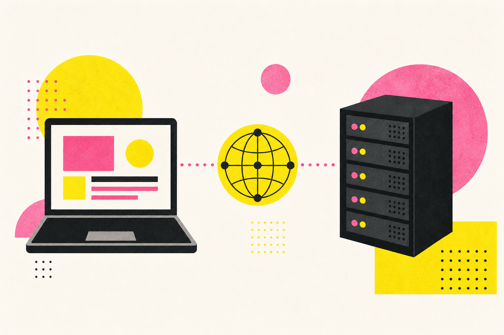

<!-- _class: title -->
<!-- _paginate: false -->

# プレゼン資料

---

<!-- _class: lead -->

# <span class="term">概要</span>を説明する

タイトル、本文、図解、コード、画像など

強調したい **キーワード** を目立たせる

---

<!-- _class: lead -->

<span class="label">重要ポイント</span>

## 伝えたい結論を<br>**短い言葉で強調**する

<p class="lead-note">補足情報は一段小さい文字で添える</p>

---

<!-- _class: section-dark -->
<!-- _paginate: false -->

# セクションの導入

---

<!-- _class: quiz -->

## このテンプレートで<br>確認できる要素は？

<div class="choices">
  <div><span>A</span>文章</div>
  <div><span>B</span>図解</div>
  <div><span>C</span>画像</div>
  <div><span>D</span>すべて</div>
</div>

<p class="note">※ 選択肢は短い言葉でそろえる</p>

---

<span class="label">フロー</span>

## 処理の流れを<br>順番に説明する

<div class="flow">
  <div>入力<br><small>データ</small></div>
  <span>→</span>
  <div>処理<br><small>ステップ1</small></div>
  <span>→</span>
  <div>確認<br><small>ステップ2</small></div>
  <span>→</span>
  <div>完了<br><small>結果</small></div>
</div>

---

## 2つの状態を比較する

<div class="two-column">
  <div>
    <h3>Before</h3>
    <p>変更前の特徴や課題を書く</p>
  </div>
  <div>
    <h3>After</h3>
    <p>変更後の効果や結果を書く</p>
  </div>
</div>

---

<!-- _class: section-dark chapter -->
<!-- _paginate: false -->

<span class="label">SECTION</span>

# ここで話題を切り替える

---

## 手順と確認項目を並べる

<div class="two-column">
  <div>
    <h3>実行手順</h3>
    <ol>
      <li>準備する</li>
      <li>実行する</li>
      <li>結果を見る</li>
    </ol>
  </div>
  <div>
    <h3>見るポイント</h3>
    <ul>
      <li>目的</li>
      <li>状態</li>
      <li>次の行動</li>
    </ul>
  </div>
</div>

---

## コード例を見せる

```js
const message = "Hello, slides!";
const result = format(message);

console.log(result);
```

<p class="note">重要な行だけに絞り、読みやすい行間を保つ</p>

---

<!-- _class: mermaid-slide -->

## Mermaidで処理フローを見せる

<div class="mermaid-frame">
  
</div>

<p class="note">フロー図・状態遷移・構成図を大きく見せる</p>

---

<!-- _class: long-copy -->

## 引用と長文を確認する

> 重要なメッセージは、引用として本文から切り分ける。

説明文が長くなる場合は、一文を短くし、適切な行幅と余白を保つ。伝えたい内容を整理して、読み手が迷わず要点を追えるようにする。

---

## 画像と要点を並べる

<div class="media-layout">
  <div>
    <ul>
      <li>左側に要点</li>
      <li>右に大きな画像</li>
      <li>説明は3つまで</li>
    </ul>
  </div>
  
</div>

---

## 表で項目を比較する

| 観点 | パターンA | パターンB |
| --- | --- | --- |
| 用途 | 基本構成 | 応用構成 |
| 情報量 | 少なめ | 多め |
| 向いている場面 | 概要説明 | 詳細比較 |

---

<!-- _class: metric-slide -->

## 数字を大きく見せる

<div class="metric-layout">
  <p class="metric-number">87<span>%</span></p>
  <div class="metric-copy">
    <h3>最も伝えたい指標</h3>
    <p>数字の意味と、そこから読み取れる結論を短く添える</p>
  </div>
</div>

---

<!-- _class: three-points -->

## 3つの要点を横に並べる

<div class="point-row">
  <div>
    <span class="point-number">01</span>
    <h3>結論</h3>
    <p>最初に伝えたい要点を書く</p>
  </div>
  <div>
    <span class="point-number">02</span>
    <h3>理由</h3>
    <p>判断の根拠を短く説明する</p>
  </div>
  <div>
    <span class="point-number">03</span>
    <h3>行動</h3>
    <p>次に行うことを明確にする</p>
  </div>
</div>

---

<!-- _class: timeline-slide -->

## タイムラインで変化を見せる

<div class="timeline">
  <div class="timeline-step">
    <div class="timeline-mark">1</div>
    <h3>準備</h3>
    <p>前提をそろえる</p>
  </div>
  <div class="timeline-step">
    <div class="timeline-mark">2</div>
    <h3>開始</h3>
    <p>小さく試す</p>
  </div>
  <div class="timeline-step">
    <div class="timeline-mark">3</div>
    <h3>展開</h3>
    <p>対象を広げる</p>
  </div>
  <div class="timeline-step">
    <div class="timeline-mark">4</div>
    <h3>定着</h3>
    <p>継続して改善する</p>
  </div>
</div>

---

<!-- _class: summary-slide -->

## まとめ

<div class="summary-layout">
  <div class="summary-list">
    <div><span>01</span><p>重要な要点を振り返る</p></div>
    <div><span>02</span><p>判断した内容を確認する</p></div>
    <div><span>03</span><p>次の行動につなげる</p></div>
  </div>
</div>
